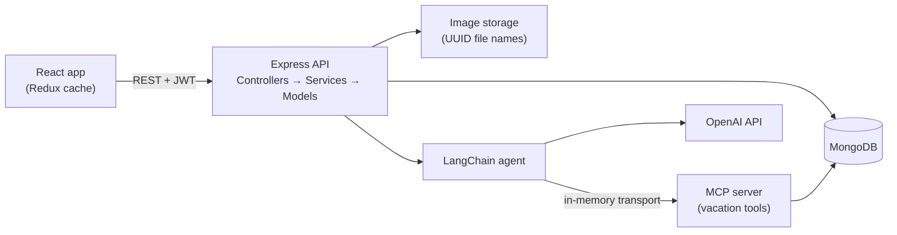

<div align="center">

# 🌴 Vacations System

**A full-stack vacations platform with likes, an admin back-office, AI recommendations and a natural-language chat backed by a real MCP server.**


</div>

---

## ✨ Features

| For users | For admins |
|---|---|
| Register, log in and browse vacations (9 per page) | Add, edit and delete vacations with image upload |
| Filter: all / liked / active now / not started yet | Likes report as a chart |
| Like and unlike a vacation, with a live likes counter | Export the report to CSV |
| **AI recommendation:** describe what you want, get destination ideas | Admin-only routes enforced on the server |
| **Ask the MCP agent:** free-text questions about the vacations database | |

## 🧱 Tech stack

| Layer | Technologies |
|---|---|
| **Frontend** | React 19, TypeScript, Vite, MUI, Redux Toolkit, React Router 7, Axios, Recharts, izitoast, Vitest + Testing Library |
| **Backend** | Node.js, Express 4, TypeScript, Mongoose 8, JWT, zod, Mocha + Chai + Supertest |
| **AI** | OpenAI, LangChain agent, `@modelcontextprotocol/sdk` (MCP server + client) |
| **Database** | MongoDB |
| **DevOps** | Docker, Docker Compose (MongoDB, backend, frontend, seed) |

## 🚀 Quick start

Requires **Docker** and **Docker Compose**.

**1. Create a `.env` file** in the project root (see `.env.example`):

```env
JWT_SECRET=choose-a-long-random-secret
HASH_SALT=choose-a-long-random-salt
OPENAI_API_KEY=your-openai-api-key
```

> The AI recommendation and the MCP chat need a valid `OPENAI_API_KEY`. Everything else works without it.

**2. Start everything:**

```bash
docker compose up -d --build
```

| Service | URL |
|---|---|
| 🖥️ Frontend | http://localhost:5173 |
| 🔌 Backend API | http://localhost:4000 |
| 🗄️ MongoDB | `localhost:27017` |

The database is seeded automatically with 14 vacations and three demo accounts.

**Starting over with a clean database** (new seed data, removes the Docker volume):

```bash
docker compose down -v && docker compose up -d --build
```

### 🔑 Demo accounts

| Role | Name | Email | Password |
|---|---|---|---|
| Admin | Dana Levi | `dana@vacations.com` | `dana1234` |
| User | Moshe Cohen | `moshe@vacations.com` | `moshe1234` |
| User | Noa Shapira | `noa@vacations.com` | `noa1234` |

> If a demo account ever returns 401 (for example after `HASH_SALT` was changed), run
> `docker compose run --rm seed` to reset its password. Changing `HASH_SALT` invalidates the passwords of all other users.

## 🏗️ Architecture



**Backend layers:** every request goes through *Controller → Service → Model*. All server code lives inside classes, validation lives in the Models, and a single catch-all middleware turns errors into HTTP responses, so there is no `try-catch` in the request flow.

### Key design decisions

- **Auth:** JWT, passwords hashed with HMAC-SHA512 and a salt. The role is always forced on the server at registration and is never trusted from the client.
- **Likes inside the user:** each user document holds a `likedVacations` array of vacation ids, so there is no separate Likes collection. Likes of a vacation are counted with a single `aggregate` (`$match` → `$unwind` → `$group`), added with `$addToSet` and removed with `$pull`. Deleting a vacation removes it from every user.
- **Redux as a cache:** loaded vacation pages are stored by `filter:page`. Going back to a page makes no server request. The cache is cleared after add / update / delete and on login, register and logout.
- **Images:** stored on disk in `Backend/src/assets/images` under UUID file names (seed images included). Only the file name is saved in MongoDB. An invalid vacation is rejected *before* its image is written, so no orphan files are left.
- **Real MCP:** a genuine MCP server exposes tools over the vacations data (counts, averages, filters by status and country). A server-side AI agent calls them through a real MCP client ↔ server connection (`InMemoryTransport`), so the OpenAI key never leaves the server and no public tunnel is needed.
- **Errors:** an unknown or malformed vacation id returns `404`, and the client shows a dedicated 404 page.

## 📡 REST API

| Method | Endpoint | Access | Description |
|---|---|---|---|
| POST | `/api/auth/register` | Public | Create a user account |
| POST | `/api/auth/login` | Public | Log in, returns a JWT |
| GET | `/api/vacations?filter=&page=` | Logged in | Paged list. Filters: `all`, `liked`, `active`, `notStarted` |
| GET | `/api/vacations/:_id` | Logged in | One vacation with `likesCount` and `likedByMe` |
| GET | `/api/vacations/images/:imageName` | Public | Vacation image |
| POST | `/api/vacations` | Admin | Add a vacation (multipart, with image) |
| PUT | `/api/vacations/:_id` | Admin | Update a vacation |
| DELETE | `/api/vacations/:_id` | Admin | Delete a vacation |
| POST | `/api/likes/:vacationId` | User | Like |
| DELETE | `/api/likes/:vacationId` | User | Unlike |
| GET | `/api/reports/likes` | Admin | Likes per destination |
| GET | `/api/reports/likes/csv` | Admin | Same report as a CSV file |
| POST | `/api/ai/recommendation` | Logged in | AI destination recommendation |
| POST | `/api/ai/ask` | Logged in | Ask the MCP agent a free-text question |

A ready-made Postman collection is in `Backend/vacations-postman-collection.json` (one folder per resource, `baseUrl` variable).

## 🧪 Tests

```bash
# Backend: Mocha + Chai + Supertest (needs MongoDB running and a .env file)
docker compose exec backend npm test

# Frontend: Vitest + Testing Library (no server needed)
cd Frontend && npm test
```

The backend tests create and delete their own users and vacations. Current status: **47 server tests and 40 client tests passing**.

## 📁 Project structure

```
.
├── Backend/
│   ├── src/
│   │   ├── ai/            MCP server, MCP client, tools and the LangChain agent
│   │   ├── controllers/   Routes (thin, they only call services)
│   │   ├── middleware/    Security (JWT, admin) and the catch-all error handler
│   │   ├── models/        Mongoose models and validation (user, vacation, AI requests)
│   │   ├── services/      Business logic (vacations, likes, users, AI)
│   │   ├── utils/         AppConfig, JWT and hashing, image saver, async handler
│   │   ├── assets/images/ Vacation images (UUID names)
│   │   ├── app.ts         Server entry point
│   │   └── seed.ts        Demo data and accounts
│   └── vacations-postman-collection.json
├── Frontend/
│   └── src/
│       ├── components/    Pages and shared components
│       ├── redux/         Store, user state and the vacations cache
│       ├── services/      API calls and client-side logic
│       ├── routing/       Routes
│       └── hooks, models, theme, utils
├── Database/              MongoDB export: vacations.json, users.json
├── docker-compose.yml
└── .env.example
```

## 🛠️ Running without Docker

```bash
# Backend (needs a local MongoDB and Backend/.env)
cd Backend && npm install && npm run seed && npm start

# Frontend
cd Frontend && npm install && npm start
```

`Backend/.env` should contain `MONGODB_CONNECTION_STRING`, `JWT_SECRET`, `HASH_SALT` and `OPENAI_API_KEY`. The frontend reads the API address from `VITE_API_BASE_URL`, so create `Frontend/.env` with `VITE_API_BASE_URL=http://localhost:4000`.

---

<div align="center">

Built by **Samuel Sion** as Course Project #3 · Full Stack Development, John Bryce

</div>
